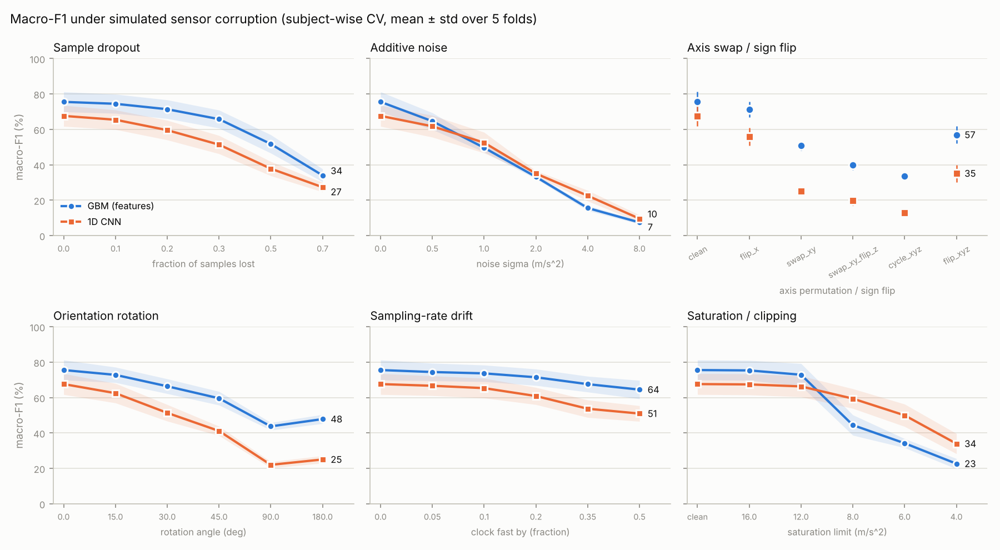
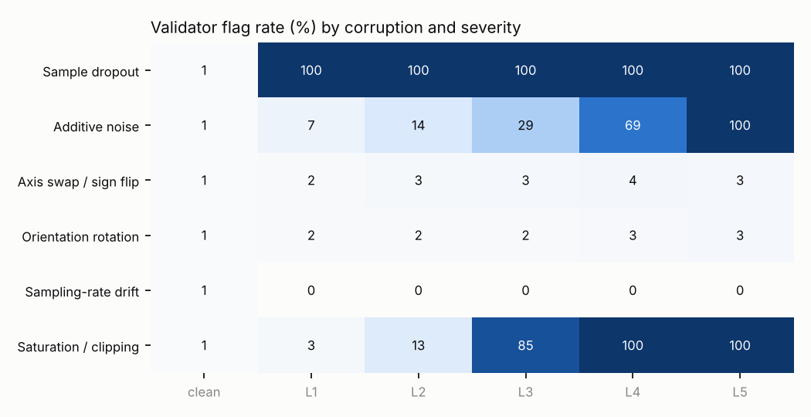
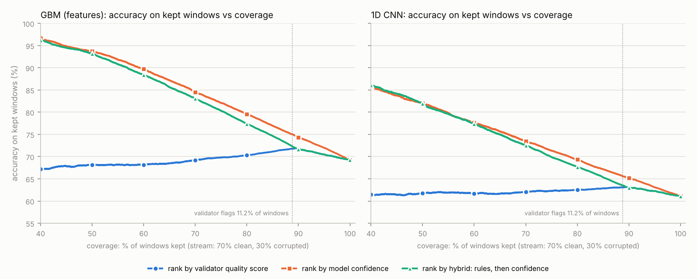

# wrist-sensor-robustness

**How fragile is a wrist-worn activity-recognition model to the things that actually go wrong with wearable sensors — and can a data-quality validator catch bad windows before the model sees them?**

This project trains two activity classifiers on public smartwatch accelerometer data, evaluates them on *people they have never seen*, breaks their input in six realistic ways at five severities, and builds a validator that scores every 10-second window before inference. The validator is then compared against the obvious alternative — just trusting the model's own confidence — at a matched rejection budget.

Everything reported below was produced by the code in this repository; every table is generated from result files by `scripts/analyze_results.py` and inlined by `scripts/build_readme.py`.

> Portfolio project built only on public data. No proprietary data, and no affiliation with any company.

---

## TL;DR

- **Leakage inflates accuracy by 15–20 points.** Splitting 10-second windows randomly (so the same person, and with 50% overlap even the same samples, land on both sides) reports ~94% accuracy for the GBM. Splitting by person gives ~75%. Only the subject-wise number is a real estimate.
- **Per-person variance is large.** Subject-wise fold accuracy for the GBM ranges from 70% to 83% depending on which 10 people are held out.
- **Small, realistic faults do large damage.** Gaussian noise of σ = 1 m/s² (≈ 0.1 g) costs the GBM ~26 macro-F1 points; a 45° change in how the watch sits on the wrist costs ~16; swapping two axes costs ~25. Rate drift is the gentlest (–11 points even at +50%).
- **The validator catches physical faults, not harm.** It flags 100% of dropout and ≥85% of moderate-to-severe clipping at ~1.4% false rejections on clean data from unseen people — but it is essentially blind to orientation changes and rate drift, and only partly sees moderate noise. Orientation faults are not detectable from a single window without knowing the activity.
- **At the same rejection budget, the model's own confidence buys more accuracy than the validator** (GBM macro-F1 74.3% vs 72.5%, from 69.6% ungated). The validator wins at a different job: it removes more *corrupted* data from what gets through (21.5% vs 27.0% of kept windows corrupted) and says *why* a window was rejected. Its continuous score adds nothing beyond its pass/fail decision.

## Problem

Activity-recognition models for wrist wearables are usually benchmarked on clean lab recordings. In deployment, the signal is degraded by Bluetooth packet loss, sensor saturation during vigorous motion, the strap rotating or the watch being worn on the other wrist, clock drift, and electrical noise. Two practical questions follow:

1. **How much does each failure mode hurt, and at what severity?**
2. **Can a cheap pre-model check reject bad windows, and is that better than relying on the model's confidence?**

## Data and license

[WISDM Smartphone and Smartwatch Activity and Biometrics Dataset](https://archive.ics.uci.edu/dataset/507) (UCI ML Repository, id 507). 51 subjects (IDs 1600–1650), 18 activities of daily living, ~3 minutes each, sampled at a nominal 20 Hz. **Only the smartwatch accelerometer** is used (`raw/watch/accel/`).

> Weiss, G. (2019). *WISDM Smartphone and Smartwatch Activity and Biometrics Dataset* [Dataset]. UCI Machine Learning Repository. https://doi.org/10.24432/C5HK59

Licensed under [CC BY 4.0](https://creativecommons.org/licenses/by/4.0/). The raw data is not redistributed here — download `wisdm-dataset.zip` from the UCI page and extract `raw/watch/accel` (and `raw/watch/gyro`, unused) into `data/raw/watch/`, plus `activity_key.txt` into `data/`.

The 18 activities: walking, jogging, stairs, sitting, standing, typing, brushing teeth, eating soup, eating chips, eating pasta, drinking, eating a sandwich, kicking a ball, playing catch, dribbling, writing, clapping, folding clothes.

### What the "clean" data actually looks like

Two properties of the raw data shaped the pipeline:

- **Real recording gaps.** The median interval between samples is 49.9 ms, but there are 460 gaps over 100 ms, 5 over 1 s, and one of 56.7 s. Naively resampling to a fixed rate fills those with fabricated straight lines. Recordings are therefore split at any gap > 250 ms and every segment is resampled and windowed on its own, so **no window ever spans a real gap**. (An A/B check with identical test subjects showed this did not change accuracy — it changes what the data honestly contains.)
- **Native saturation.** 22% of clean windows touch ±19.6 m/s² (≈ ±2 g), concentrated in jogging, dribbling, catch and kicking. This is in-distribution sensor behaviour the model is trained on, so the validator's clipping rule is calibrated to flag clipping *worse* than this (see below), not jogging.

## Method

**Windowing.** 10-second windows, 50% overlap (200 samples at 20 Hz), after removing malformed lines and duplicate timestamps, splitting at gaps, and linearly resampling each segment onto an exact 50 ms grid. Windows are never zero-padded. Result: 31,014 windows.

**Models** (both take raw windows; all statistics fit on the training fold only):

| model | input | details |
|---|---|---|
| GBM | 71 hand-crafted features | XGBoost (300 trees, depth 6). Per axis and for the orientation-invariant magnitude \|a\|: mean, std, min/max, 10/50/90th percentiles, mean absolute first difference, zero-crossing rate, spectral energy, energy fraction in 0–1/1–3/3–5/5–10 Hz bands, dominant frequency, and a cadence feature (period and strength of the strongest autocorrelation peak in 0.25–2 s). Plus xy/xz/yz correlations. |
| 1D CNN | standardized raw window (200 × 3) | 3 × [Conv1D(k=7, stride 2) → ReLU] with 16/32/64 filters → global average pool → dense → softmax. 19,538 parameters, Adam (lr 3e-3), 20 epochs. The 3-block depth was chosen over 2 blocks on *held-out training subjects* of fold 0, never on test data. |

The CNN is written from scratch in NumPy (forward and backward pass). PyTorch's CPU wheel index was unreachable from the build environment, and the default PyPI wheel pulls several GB of CUDA packages — the wrong footprint for a model meant to be small. The hand-written backprop is verified by a finite-difference **gradient check** against every parameter of a small 3-block network (worst relative error 1.9e-8; the test suite re-checks a sample on every run) before any result from it is trusted.

**Validation is subject-wise**: 5-fold `GroupKFold` by person (10–11 test subjects per fold, subjects shuffled with a fixed seed). A **random-window** 5-fold split is run only to measure leakage. Reported numbers are mean ± std over the 5 folds.

**Corruption simulator** (`src/wrist_sensor_robustness/corruptions.py`) — six failure modes, severity level 0 (clean) to 5, seeded and reproducible:

| corruption | unit | L0 | L1 | L2 | L3 | L4 | L5 |
|---|---|---|---|---|---|---|---|
| Sample dropout | fraction of samples lost | 0.0 | 0.1 | 0.2 | 0.3 | 0.5 | 0.7 |
| Additive noise | noise sigma (m/s^2) | 0.0 | 0.5 | 1.0 | 2.0 | 4.0 | 8.0 |
| Axis swap / sign flip | axis permutation / sign flip | None | flip_x | swap_xy | swap_xy_flip_z | cycle_xyz | flip_xyz |
| Orientation rotation | rotation angle (deg) | 0.0 | 15.0 | 30.0 | 45.0 | 90.0 | 180.0 |
| Sampling-rate drift | clock fast by (fraction) | 0.0 | 0.05 | 0.1 | 0.2 | 0.35 | 0.5 |
| Saturation / clipping | saturation limit (m/s^2) | None | 16.0 | 12.0 | 8.0 | 6.0 | 4.0 |

Dropout is simulated as contiguous bursts filled by linear interpolation — exactly what this pipeline's resampler does across a real gap, so the model sees what it would see in deployment. Axis-swap levels are *distinct transforms*, not an ordered scale. Rate drift simulates only the "clock runs fast" direction (motion appears slowed); the other direction needs samples beyond the window and would add simulator artifacts.

**Data-quality validator** (`src/wrist_sensor_robustness/quality.py`), applied to each window before inference:

| check | what it catches | threshold (calibrated on clean data) |
|---|---|---|
| flatline | stuck / frozen sensor | ≥ 5 identical consecutive samples (clean data never has even 2) |
| gap | dropout bridged by interpolation | ≥ 10 perfectly linear samples (clean max: 3); also a direct timestamp check when timestamps are supplied |
| clipping | saturation worse than the sensor's native ±2 g | > 10% of samples pinned at the window's extremes (clean max: 8%) |
| noise | excess high-frequency noise *for how much the wearer is moving* | robust noise estimate above the 99.5th percentile within 10 motion-amplitude bins of training data |
| magnitude | scaling / gross saturation faults | mean \|a\| outside the training range ± 10% |
| learned anomaly | anything else unusual | IsolationForest on the 71 features; score converted to a tail probability against held-out *training subjects*, flag below 0.01 |

`quality_score` is that tail probability (≈ Uniform(0,1) on clean data from unseen people) if every rule passes, otherwise 0. The validator is re-fit inside each CV fold on that fold's training subjects only.

## Results

### 1. Subject-wise vs leaky evaluation

| model | split | accuracy % | macro-F1 % |
|---|---|---|---|
| GBM (features) | subject-wise (5-fold, by person) | 75.2 ± 4.7 | 75.7 ± 4.2 |
| GBM (features) | random windows (leaky) | 93.6 ± 0.3 | 93.6 ± 0.2 |
| GBM (features) | **leakage inflation** | +18.3 pts | +17.8 pts |
| 1D CNN | subject-wise (5-fold, by person) | 67.3 ± 5.4 | 67.6 ± 5.1 |
| 1D CNN | random windows (leaky) | 83.2 ± 0.7 | 83.3 ± 0.6 |
| 1D CNN | **leakage inflation** | +15.9 pts | +15.7 pts |

Per-fold accuracy (subject-wise), showing how much depends on *which* people are held out:

| fold | cnn_1d | gbm_features |
|---|---|---|
| 0 | 0.642 | 0.726 |
| 1 | 0.646 | 0.704 |
| 2 | 0.732 | 0.789 |
| 3 | 0.741 | 0.827 |
| 4 | 0.605 | 0.716 |

### 2. Robustness: macro-F1 (%) by corruption and severity

Measured on a seeded sample of 2,000 held-out windows per fold (10,000 in total), with the subject-wise fold models.



| corruption | model | L0 | L1 | L2 | L3 | L4 | L5 | drop at L5 (pts) |
|---|---|---|---|---|---|---|---|---|
| Sample dropout | GBM | 75.5 | 74.4 | 71.4 | 65.8 | 51.8 | 34.0 | 41.5 |
| Sample dropout | CNN | 67.6 | 65.4 | 59.6 | 51.4 | 37.8 | 27.3 | 40.3 |
| Additive noise | GBM | 75.5 | 64.6 | 49.6 | 33.2 | 15.6 | 7.4 | 68.1 |
| Additive noise | CNN | 67.6 | 61.7 | 52.5 | 35.0 | 22.5 | 9.6 | 58.0 |
| Axis swap / sign flip | GBM | 75.5 | 71.3 | 50.8 | 39.8 | 33.7 | 57.0 | 18.6 |
| Axis swap / sign flip | CNN | 67.6 | 55.9 | 25.2 | 19.8 | 12.9 | 35.1 | 32.5 |
| Orientation rotation | GBM | 75.5 | 72.8 | 66.4 | 59.6 | 43.7 | 47.8 | 27.7 |
| Orientation rotation | CNN | 67.6 | 62.5 | 51.4 | 41.1 | 22.0 | 25.0 | 42.6 |
| Sampling-rate drift | GBM | 75.5 | 74.4 | 73.7 | 71.5 | 67.6 | 64.5 | 11.1 |
| Sampling-rate drift | CNN | 67.6 | 66.6 | 65.3 | 60.9 | 53.7 | 51.0 | 16.7 |
| Saturation / clipping | GBM | 75.5 | 75.3 | 72.9 | 44.4 | 34.2 | 22.6 | 52.9 |
| Saturation / clipping | CNN | 67.6 | 67.4 | 66.3 | 59.4 | 50.0 | 34.0 | 33.7 |

Observations:

- **Noise is the most damaging per unit of physical severity.** The GBM loses ~11 points already at σ = 0.5 m/s² (the CNN ~6), and both fall below 35% by σ = 2. Several hand-crafted features (zero-crossing rate, mean absolute difference, high-band energy) are directly inflated by noise, which plausibly explains why the GBM is the more noise-sensitive of the two at low noise.
- **Orientation faults hit the CNN much harder than the GBM.** The GBM's magnitude features are rotation-invariant (verified by a unit test); the CNN learns directly from axis-specific waveforms. At 90° rotation the CNN falls to ~22% macro-F1 versus ~44% for the GBM.
- **Clipping is the reverse:** the GBM collapses faster once the limit drops below the native ±2 g, presumably because its extremes/percentile features saturate, while the CNN degrades more gradually.
- **Non-monotonic curves are real, not noise:** flipping *all three* axes (`flip_xyz`) hurts less than permuting two, and 180° rotation slightly less than 90° — the magnitude channel and some symmetric features survive those transforms.

### 3. What the validator catches — and what it misses



| corruption | L0 | L1 | L2 | L3 | L4 | L5 |
|---|---|---|---|---|---|---|
| Sample dropout | 1.4 | 100.0 | 100.0 | 100.0 | 100.0 | 100.0 |
| Additive noise | 1.4 | 6.5 | 14.1 | 29.1 | 68.7 | 100.0 |
| Axis swap / sign flip | 1.4 | 1.6 | 3.0 | 3.1 | 3.7 | 3.2 |
| Orientation rotation | 1.4 | 1.7 | 1.8 | 2.1 | 2.7 | 3.3 |
| Sampling-rate drift | 1.4 | 0.3 | 0.3 | 0.3 | 0.2 | 0.3 |
| Saturation / clipping | 1.4 | 2.7 | 12.6 | 85.4 | 99.8 | 100.0 |

Set against how much each corruption actually hurts the GBM:

| corruption | level | GBM macro-F1 loss (pts) | validator flag rate % |
|---|---|---|---|
| Sample dropout | L1 (0.1) | 1.1 | 100.0 |
| Sample dropout | L3 (0.3) | 9.7 | 100.0 |
| Sample dropout | L5 (0.7) | 41.5 | 100.0 |
| Additive noise | L1 (0.5) | 10.9 | 6.5 |
| Additive noise | L3 (2.0) | 42.4 | 29.1 |
| Additive noise | L5 (8.0) | 68.1 | 100.0 |
| Axis swap / sign flip | L1 (flip_x) | 4.2 | 1.6 |
| Axis swap / sign flip | L3 (swap_xy_flip_z) | 35.7 | 3.1 |
| Axis swap / sign flip | L5 (flip_xyz) | 18.6 | 3.2 |
| Orientation rotation | L1 (15.0) | 2.7 | 1.7 |
| Orientation rotation | L3 (45.0) | 15.9 | 2.1 |
| Orientation rotation | L5 (180.0) | 27.7 | 3.3 |
| Sampling-rate drift | L1 (0.05) | 1.1 | 0.3 |
| Sampling-rate drift | L3 (0.2) | 4.1 | 0.3 |
| Sampling-rate drift | L5 (0.5) | 11.1 | 0.3 |
| Saturation / clipping | L1 (16.0) | 0.2 | 2.7 |
| Saturation / clipping | L3 (8.0) | 31.1 | 85.4 |
| Saturation / clipping | L5 (4.0) | 52.9 | 100.0 |

The mismatch is the main lesson. Dropout at 10% costs one F1 point and is flagged 100% of the time; noise at σ = 2 m/s² costs 42 points and is flagged 29% of the time; a 45° rotation costs 16 points and is essentially never flagged. **Rule-based validation detects broken *data*, not broken *predictions*.** Orientation changes and rate drift produce windows that are perfectly plausible motion — just not the motion the model expects — so no single-window check without knowledge of the activity can see them. Those faults have to be handled with robustness (orientation-invariant features, augmentation), not gating.

**Iteration note (disclosed).** Version 1 of the validator had no noise rule and caught 1–2% of σ ≤ 2 m/s² noise. The motion-conditioned noise rule was added after measuring that blind spot (design choices were explored on fold 0); its thresholds are fit on each fold's training data only. It raised noise detection to 7/14/29/69% at levels 1–4, at the cost of clean false rejections rising from 1.1% to 1.4%. Version-1 tables are kept in `results/tables/validator_v1/`.

### 4. Gating: does rejecting bad windows improve reliability?

Scenario: a deployment-like stream built from each fold's held-out windows — each window is clean with probability 0.7, otherwise hit by a random corruption at a random severity 1–5 (seeded; every gate sees the identical stream). Each gate is compared **at the same rejection rate** as the validator.

| model | gate | windows rejected % | accuracy % | macro-F1 % | corrupted share of kept % |
|---|---|---|---|---|---|
| GBM (features) | none | 0.0 | 69.2 ± 5.3 | 69.6 ± 4.9 | 30.0 (by construction) |
| GBM (features) | validator | 11.2 ± 1.3 | 71.7 ± 5.5 | 72.5 ± 5.1 | 21.5 |
| GBM (features) | confidence | 11.2 ± 1.3 | 74.9 ± 5.5 | 74.3 ± 5.1 | 27.0 |
| GBM (features) | hybrid: rules + confidence | 11.2 ± 1.3 | 72.3 ± 5.7 | 72.8 ± 5.2 | 21.6 |
| 1D CNN | none | 0.0 | 61.1 ± 5.4 | 61.3 ± 5.2 | 30.0 (by construction) |
| 1D CNN | validator | 11.2 ± 1.3 | 63.1 ± 5.6 | 63.5 ± 5.4 | 21.5 |
| 1D CNN | confidence | 11.2 ± 1.3 | 65.7 ± 5.7 | 64.7 ± 5.4 | 28.6 |
| 1D CNN | hybrid: rules + confidence | 11.2 ± 1.3 | 63.6 ± 5.8 | 63.8 ± 5.5 | 21.7 |

| model | validator rejects: clean / corrupted windows % | model error rate: rejected vs kept % |
|---|---|---|
| GBM (features) | 1.3 / 35.0 | 50.7 vs 28.3 |
| 1D CNN | 1.3 / 35.0 | 54.5 vs 36.9 |



**The trade-off, honestly:**

- The validator rejects ~11% of windows (1.3% of clean, 35% of corrupted) and raises GBM macro-F1 from 69.6% to 72.5%. Rejected windows have a 51% model error rate versus 28% for kept ones, so its rejections are well targeted.
- **Rejecting the same number of lowest-confidence windows works better for accuracy** (74.3%). Confidence directly targets likely errors; the validator targets broken inputs, some of which the model still gets right (e.g. light dropout).
- **But the validator is better at keeping corrupted data out** of what gets through (21.5% of kept windows corrupted vs 27.0%), and it returns a *reason* ("gap", "clipping", "noise") — which is what you need to alert on a failing sensor or fix firmware, and which confidence cannot provide. It also runs *before* the model, so it doesn't depend on the model being well calibrated under shift.
- **The validator's continuous score is not a useful ranking.** Beyond its pass/fail decision, keeping fewer windows ordered by quality score does not raise accuracy (flat blue curve): among windows that pass the rules, the score is calibrated to be uniform on clean data, and so carries no information about correctness. Use the flag, not the score, as the gate.
- In practice the two are complementary: reject physical faults outright (they are bad data regardless of the model's opinion), then threshold confidence on what remains. At an ~11% budget the rule failures consume most of the budget, so the hybrid lands between the two (72.8%); at larger budgets it stays within about 2 points of pure confidence gating while still guaranteeing physical faults are excluded.

## API

```bash
make train-final      # fit the served GBM + validator on all 51 subjects
make serve            # uvicorn on :8000
```

`POST /predict` takes one 10 s window and returns a prediction, a quality score and a flag. Flagged windows are rejected **before the model runs** (`prediction: null`) unless `"force": true`.

```bash
curl -s localhost:8000/predict -H 'content-type: application/json' \
  -d '{"samples": [[x, y, z], ... 200 rows ...], "timestamps_ns": [... optional ...]}'
```

Response fields: `prediction` (activity name, or `null` if rejected), `activity_code`, `probabilities` (top 3), `quality_score` (0–1), `flagged` (bool), `reasons` (e.g. `["gap", "clipping"]`), `checks` (the raw value behind every rule, so a rejection is auditable), and `model_run` (bool). `GET /health` reports the loaded model and validator settings.

Real responses from `scripts/demo_api.py` — one held-out walking window, clean and corrupted (served model trained on all subjects, so this shows behaviour, not held-out accuracy):

```
window 1261: subject 1602, true activity A (walking)

clean        {"prediction": "walking", "quality_score": 0.7105, "flagged": false, "reasons": [], "model_run": true}
dropout L2   {"prediction": null, "quality_score": 0.0, "flagged": true, "reasons": ["gap"], "model_run": false}
clipping L4  {"prediction": null, "quality_score": 0.0, "flagged": true, "reasons": ["clipping", "magnitude_out_of_range"], "model_run": false}
noise L5     {"prediction": null, "quality_score": 0.0, "flagged": true, "reasons": ["noise", "anomalous_pattern"], "model_run": false}
rotation L4  {"prediction": "walking", "quality_score": 0.3185, "flagged": false, "reasons": [], "model_run": true}
```

Inputs are validated (exactly 200 × 3 finite values, strictly increasing timestamps); malformed requests get a 422.

## Repository layout

```
src/wrist_sensor_robustness/
  config.py        paths, window size, seeds
  data.py          load -> clean -> split at gaps -> resample -> window
  features.py      71 hand-crafted features
  cnn.py           NumPy 1D CNN with manual backprop
  models.py        FeatureGBM / CNNModel with a shared fit/predict API
  evaluation.py    subject-wise and random-window splits, metrics
  corruptions.py   six corruption families x five severities
  quality.py       rule checks + IsolationForest validator
  api.py           FastAPI service
scripts/           run_baseline, run_robustness, analyze_results, train_final, demo_api, build_readme
tests/             76 tests: loading, windowing, corruptions, CNN gradient check, models, validator, API
results/tables/    generated tables (.md / .csv)
results/plots/     generated figures
MODEL_CARD.md
```

## How to run

```bash
pip install -r requirements.txt
# put the WISDM watch accelerometer files in data/raw/watch/accel/ and activity_key.txt in data/
make test         # ~15 s
make data         # build the 31,014-window cache (~20 s)
make baseline     # subject-wise + random-window CV, both models (~1 h on 2 CPU cores)
make robustness   # corruption sweep + validator records (~8 min)
make analyze      # tables + plots
make train-final && make serve
python3 scripts/build_readme.py   # re-render this README from the tables
```

All randomness is seeded (`config.RANDOM_SEED = 42`, plus per-fold/per-corruption derived seeds). Tested with the pinned versions in `requirements.txt` on Python 3.13, CPU only.

## Limitations

- **Lab data, one dataset.** WISDM was recorded under scripted conditions with one watch model, one wrist placement and 51 volunteers. Real-world wear (free-living behaviour, other devices, other populations, transitions between activities) will be harder, and nothing here has been validated on it.
- **Simulated corruptions.** The six failure modes are simplified models of real faults (e.g. i.i.d. Gaussian noise, a single static rotation per window, uniform clock drift). Real faults are messier, correlated in time, and often co-occur. The mixed-stream mix (70/30, uniform over types and levels) is an assumption, not a measured field distribution.
- **No real participant-level shift beyond 51 people.** The fold-to-fold spread (70–83% GBM accuracy) shows results depend heavily on who is in the test set; with more subjects the estimate would tighten.
- **Validator design was iterated** once after seeing results (the noise rule; disclosed above). Its thresholds are fit on training folds, but the choice of rule was informed by fold-0 test behaviour.
- **The validator cannot detect orientation changes or rate drift** from a single window, and only partly detects moderate noise. It should be paired with robustness measures, not relied on alone.
- **Models are deliberately small and untuned** (one architecture choice for the CNN on inner validation; default-ish GBM hyperparameters). The goal is fragility analysis, not state-of-the-art accuracy. The gyroscope is not used.
- **Robustness metrics use a 2,000-window sample per fold** rather than the full held-out fold, to keep the sweep laptop-sized.
- **Not a medical or safety device.** Do not use these models for clinical, insurance, or safety decisions.

See [MODEL_CARD.md](MODEL_CARD.md) for intended use and evaluation details.

## License

Code: MIT. Data: WISDM, CC BY 4.0, © its authors — cite Weiss (2019), DOI [10.24432/C5HK59](https://doi.org/10.24432/C5HK59).
